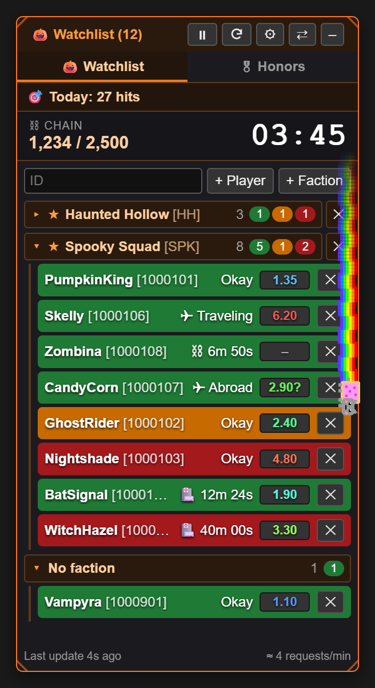

# 🎃 Torn War Watchlist

**Keep an eye on your ranked war targets: who is online, who is in hospital, how strong they are and how much time the chain has left – all in one small panel right inside Torn.**

### [⬇️ Install now](https://raw.githubusercontent.com/Provadis/torn-war-watchlist/main/torn-war-watchlist.user.js)

> [!NOTE]
> A fun project, **built entirely with AI**. Use at your own risk – see the [disclaimer](#%EF%B8%8F-disclaimer) at the bottom.

---

## 📑 Contents

- [Features](#-features)
- [Installation & updates](#-installation--updates)
- [Setup](#-setup)
- [API usage](#-api-usage)
- [Legend](#-legend)
- [Privacy](#-privacy)
- [FAQ & troubleshooting](#-faq--troubleshooting)
- [Changelog](#-changelog)
- [Kurzfassung auf Deutsch](#-kurzfassung-auf-deutsch)
- [Disclaimer](#%EF%B8%8F-disclaimer)

---

## ✨ Features

### 👥 Watchlist for players and whole factions
- **Single players:** add them by ID or right on their profile („+ Add player“).
- **Whole factions:** same thing, on the faction page or on a member's profile („+ Add faction“).
- **Cheap on calls:** a faction costs **one single API call** (`/v2/faction/{id}/members`), no matter how many members it has.
- **Hiding:** hide single faction members with ✕, bring them all back with ↺.
- **Groups:** players are grouped by faction, and each group can be collapsed. The colored counters in the group header show who has been away how long, even when the group is collapsed.

### ⚔ Buttons in the ranked war list
On the ranked war page, hovering an enemy's row pops up two small buttons over the right end of their name (on touch screens they are always visible):
- **+** puts the player on your watchlist. Once they are on it, it turns into a green **✓** – click it again to remove them.
- **📋 Copy** puts `Name [ID]` into the clipboard as a link to their profile, plus a plain-text version (`Name [ID] – profile link`) for chats that only take text.

Both read name and ID straight from the row – no API calls. They also survive Torn redrawing the list and work alongside other scripts' columns (e.g. FF Scouter).

### 🟢🟠🔴 Colors by last action
| Color | Meaning |
|---|---|
| 🟩 Green | inactive for more than 15 min – probably offline |
| 🟧 Orange | inactive for 10–15 min |
| 🟥 Red | less than 10 min – active right now |

### 🏥 Hospital countdown & status
Instead of „offline for …“ every row shows the **status**:
- **Okay** = can be attacked
- **🏥 12m 30s** = hospital time left
- **⛓** = jail time left
- **✈** = traveling or abroad

The list is sorted so that attackable players come first (longest inactive on top). Players in hospital follow, whoever gets out next first.

### 📊 FF Scouter
Shows every player's **fair fight score** from [ffscouter.com](https://ffscouter.com):
- **Color:** blue = easy, green/yellow = moderate, red = difficult.
- **Tooltip:** estimated stats and how old the estimate is.
- **Requests:** up to 100 players per call, cached for 30 minutes.
- **🔄 Reload FF** (⚙ → FF Scouter) clears that cache and fetches all scores right away – handy after the gym, since FF depends on your own stats too.

### ⛓ Chain timer with alarm
- The script reads the chain straight from the page (sidebar or attack page) and shows it big. This costs no API calls.
- **Below 1:30** the box blinks red and the whole panel glows.
- Optional **💣 bomb sound**: beeps from 1:30, faster and faster from 0:30, and explodes with a flash at 0. A landed hit defuses the bomb.

  
  &nbsp;&nbsp;
  

### 🎯 Today's hits
Counts your **successful attacks since 00:00 TCT**. This needs a key with Limited access.

### 🪟 Movable & resizable
- **Move:** drag the header. Double-click docks the panel back to the edge.
- **Resize** from any of the four corners (bigger handles on touch screens). A saved size that doesn't fit the screen – e.g. imported from a PC onto a phone – is shrunk to fit automatically.
- **Collapse** with –.

Everything is saved and shared across all Torn tabs.

### ⚙ Settings & language
All options live on their own settings page behind **⚙**. The UI is available in **English and German** and switches instantly, without a reload. At the bottom of the settings page there is a **legend** explaining every marker.

  
  &nbsp;&nbsp;
  

### 💾 Export, import & backup
- **⬇ Export / ⬆ Import:** save settings, API keys, players and factions to a file and restore them.
- **Automatic backup:** everything is also backed up in the browser's storage and restored automatically on load if the Tampermonkey storage ever ends up empty.

### 🌈 Nyan Cat
Runs around the panel border every now and then, rainbow included – but not while the panel is collapsed. Can be switched off. Just because.

---

## 📥 Installation & updates

1. Install **[Tampermonkey](https://www.tampermonkey.net/)** in your browser (Chrome, Edge, Firefox, Opera …).
2. **[Open this link](https://raw.githubusercontent.com/Provadis/torn-war-watchlist/main/torn-war-watchlist.user.js)** → Tampermonkey shows its install page → **Install**.
3. Reload [torn.com](https://www.torn.com) – the 🎃 panel appears on the right.

### 📱 iPhone / iPad
Works with [Tampermonkey for Safari](https://apps.apple.com/app/tampermonkey/id6738342400) (iOS 15+):
1. Install Tampermonkey from the App Store.
2. *Settings → Safari → Extensions → Tampermonkey*: turn it on and allow it for torn.com (or all websites).
3. Open the [install link](https://raw.githubusercontent.com/Provadis/torn-war-watchlist/main/torn-war-watchlist.user.js) in **Safari** and install.
4. Move your list and keys over with ⬇ Export on the PC and ⬆ Import on the phone.

On touch screens the resize corners are bigger and the war list buttons are always visible. In Torn's mobile header a small orange **P** button sits right after the ☰ menu. While a chain runs, a timer badge appears next to it (e.g. **⛓ 03:45**, just **03:45** if space is tight) and blinks red below 1:30. Torn's mobile chain bar has no timer, so on touch screens the timer comes from the Torn API – every 6 seconds while a chain runs, and not at all otherwise (plus one request on page load and whenever the chain count changes). Tapping it opens the watchlist right below Torn's header in full screen height – the rest of Torn moves down underneath; tap again (or –) to close it. If the header layout isn't recognized, the panel falls back to a floating **P** square you can tap and drag.

The ⚙ settings page is touch-friendly too: every on/off option is a big tile you tap (orange = on, grey = off), keys and data are dashed tiles, and language and update interval are tap bars (15 s – 5 min).

### Updates
- **Automatic:** Tampermonkey checks for new versions on its own, once a day by default. You can change the interval under *Tampermonkey → Settings → Script update check interval*.
- **Right away:** ⚙ → **🔄 Check for updates** shows whether a newer version is on GitHub. To install it, use *Check for userscript updates* in the Tampermonkey menu (on a PC the „Install“ link next to the result works too).
- **Your data survives updates:** list, keys and settings stay.

---

## 🔧 Setup

| What | Where | Note |
|---|---|---|
| **Torn API key** | ⚙ → 🔑 Torn API key | *Public* is enough for the watchlist. **Today's hits** needs *Limited*. |
| **FF Scouter** | ⚙ → tick 📊 FF Scouter → **Key** | A Torn API key registered at [ffscouter.com](https://ffscouter.com). Leave empty to use the watchlist key. |
| **Update interval** | ⚙ → Update every … s | 15–600 seconds, default 60. |
| **Language** | ⚙ → Language | English / Deutsch |

---

## 📈 API usage

Torn allows **100 requests per minute per account**, for all keys combined. Per update the watchlist needs:

- **1 call per watched faction**, no matter how many members
- **1 call per single player** not already covered by a faction
- **1 call** for today's hits (if enabled)

The current rate is shown **bottom right in the panel** (e.g. „≈ 4 requests/min“) and turns orange above 60/min.

More ways the script saves calls:
- With several Torn tabs open, **only one tab** makes requests; the others get the data via the shared storage.
- ⏸ pauses all requests.
- FF Scouter requests go to ffscouter.com and don't count against Torn's limit.

---

## 📖 Legend

| Marker | Meaning |
|---|---|
| 🟩 / 🟧 / 🟥 row | last action: > 15 min / 10–15 min / < 10 min |
| ⬛ gray row | no data yet |
| `Okay` | not in hospital – can be attacked |
| `🏥 12m 30s` | in hospital, time left |
| `⛓ 5m 00s` | in jail, time left |
| `✈ Traveling` / `✈ Abroad` | currently flying / is abroad |
| FF **blue → red** | easy → difficult |
| `2.10?` | FF estimate older than 14 days |
| `–` / `…` | no FF data / loading |
| ★ | faction is on the watchlist |
| ⛓ blinking red | chain timer below 1:30 |
| ✕ / ↺ | remove or hide / restore |

The same legend is built into the script under **⚙ → 📖 Legend**, with a made-up example player.

 

---

## 🔒 Privacy

- **Your API keys and lists stay local:** in the Tampermonkey storage, plus a backup in torn.com's `localStorage`. They are not in the code and are never uploaded.
- **Network:** the script only talks to `api.torn.com` and (if enabled) `ffscouter.com`.
- ⚠️ **The export file contains your API key in plain text.** Don't share it.
- ⚠️ Other userscripts running on torn.com could read the `localStorage` backup.

---

## ❓ FAQ & troubleshooting

<b>The footer says „No API key set“ or shows an API error</b>

Check your key under ⚙ → 🔑 Torn API key. „Incorrect key“ means the key is wrong or was deleted.

<b>Today's hits shows „needs a Limited key“</b>

Torn only returns the attack list for keys with at least *Limited access*. Create a new key in Torn under *Settings → API Keys* and enter it.

<b>FF Scouter: „Key not registered with FF Scouter“</b>

Register the key once at [ffscouter.com](https://ffscouter.com), or enter a key that is registered there under ⚙ → FF Scouter → **Key**.

<b>The bomb sound stays silent</b>

Browsers only play sound after you have clicked on the page or pressed a key once since it loaded. Try it with ⚙ → ▶ Test. With several tabs open, only one beeps, preferably the visible one.

<b>The chain box is missing or shows nonsense</b>

The chain is read from Torn's sidebar or the attack page. Check that ⚙ → Chain timer is ticked. If Torn changes its layout, reading may break – please open an issue with a screenshot.

<b>iPhone: the install link only shows code / Tampermonkey finds no update</b>

- **Code instead of an install screen:** Tampermonkey can only take over pages it is allowed on. Allow it for all websites (*Settings → Safari → Extensions → Tampermonkey*), or open the link and choose *Aa / puzzle icon → Tampermonkey → Always allow on this website*. If it still shows code, briefly turn off Safari's pop-up blocker while installing.
- **No update found:** GitHub serves the normal file address from a cache for up to ~5 minutes after a release, so Tampermonkey's own check may still see the old version – try again a little later, or use ⚙ → 🔄 Check for updates, which sees new releases right away and links the install to the fresh file. If the script was created by pasting the code, install it once via the link, so Tampermonkey keeps it updated.

<b>My list is gone after a reload</b>

The script restores its browser backup automatically. If something is still missing: ⚙ → ⬆ Import with your latest export file.

---

## 📝 Changelog

| Version | What's new |
|---|---|
| **2.17.0** | Touch settings as a grid: on/off tiles (orange = on), key tiles, tap bars for language and update interval; volume only shows while the bomb sound is on. Desktop keeps the classic rows |
| **2.16.5** | „Check for updates“ finds a new release right away (asks GitHub for the newest commit instead of the cached file) and links the install to exactly that file |
| **2.16.4** | Header timer badge (and its API requests) respect the chain timer setting |
| **2.16.3** | No tooltip on the header P button (it stuck on iPhone after a tap) |
| **2.16.2** | Smooth mobile chain timer: bypasses Torn's API cache and counts down to an absolute end time (no more jumping back up) |
| **2.16.1** | P button in the header reliably toggles on iPhone (reacts to the touch directly, sits above Torn's header elements) |
| **2.16.0** | Touch screens: P button and chain timer badge in Torn's header, watchlist opens inline below the header in full height, chain timer via API (every 6 s while a chain runs) |
| **2.15.0** | „P“ square for a collapsed panel on touch screens, Nyan Cat pauses while collapsed |
| **2.14.0** | Resize from all four corners (touch-friendly), panel always fits the screen, update check inside the script, iPhone instructions |
| **2.13.1** | War list buttons only appear on hover, as a small overlay |
| **2.13.0** | + and copy buttons next to every enemy in the ranked war list |
| **2.12.1** | „🔄 Reload FF“ button to refetch all FF scores right away |
| **2.12.0** | English as the default language, code comments and README in English |
| **2.11.0** | Automatic updates via GitHub, version display and „Check for updates“, anonymized legend |
| **2.10.x** | Legend in the settings, scrollbars in the panel style, requests/min in the footer |
| **2.9.0** | Separate settings page, English/German, status before the FF score |
| **2.8.0** | FF Scouter integration |
| **2.7.x** | Export/import, automatic browser backup, chain display fix |
| **2.6.0** | Bomb sound for the chain timer |
| **2.5.0** | Freely movable panel |
| **≤ 2.4** | Watchlist, factions with one call, groups, hospital countdown, today's hits, chain timer, Nyan Cat |

---

## 🇩🇪 Kurzfassung auf Deutsch

**Torn War Watchlist** ist ein Tampermonkey-Userscript für Ranked Wars in [Torn City](https://www.torn.com). Es zeigt ein kompaktes Panel mit deinen Gegnern:
- **Zeilenfarbe nach Last Action:** grün über 15 min, orange 10–15 min, rot unter 10 min.
- **Status:** Hospital-/Jail-Countdown, unterwegs, im Ausland.
- **FF-Scouter-Werte.**
- **Chain-Timer:** große Anzeige mit rotem Alarm (optional mit Bomben-Sound) unter 1:30.
- **Zähler für die heutigen Hits.**

Ganze Factions kosten nur einen API-Call pro Update. Die Oberfläche gibt es auf **Englisch und Deutsch**: ⚙ → Sprache.

**Installation:** [Tampermonkey](https://www.tampermonkey.net/) installieren und den [Installations-Link](https://raw.githubusercontent.com/Provadis/torn-war-watchlist/main/torn-war-watchlist.user.js) öffnen. Updates kommen danach automatisch. Deine API-Keys bleiben in deinem Browser und gehen nur an `api.torn.com` und `ffscouter.com`.

---

## ⚠️ Disclaimer

> [!CAUTION]
> ### 🤖 Built entirely with AI · 🎉 Just for fun · 🛡️ Use at your own risk
>
> - **AI-generated:** this project – code, texts and images – was **created entirely with AI**. There was no professional code review and no extensive testing on Torn itself.
> - **Just for fun:** the script was made **for fun** for a Halloween ranked war. It is not an official Torn tool and has no affiliation with Torn or ffscouter.com.
> - **No liability:** you use it **at your own risk**. I accept **no liability whatsoever** – not for bugs, wrong data, missed chains or hits, locked or used-up API keys, data loss or any other consequences.
> - **Rules:** you are responsible for making sure your use complies with the [Torn rules](https://www.torn.com/rules.php) and the API terms of use.
> - **No warranty:** the software is provided as is, without any warranty (see the [MIT license](LICENSE)).
>
> ---
>
> **🇩🇪 Deutsch:** Dieses Projekt wurde **vollständig mit KI entwickelt**, ist **nur aus Spaß** entstanden und wird **auf eigene Gefahr** benutzt. Es steht in keiner Verbindung zu Torn oder ffscouter.com. Ich übernehme **keinerlei Haftung**. Ohne Gewähr.

Made with 🎃 and 🤖 for the Halloween war

