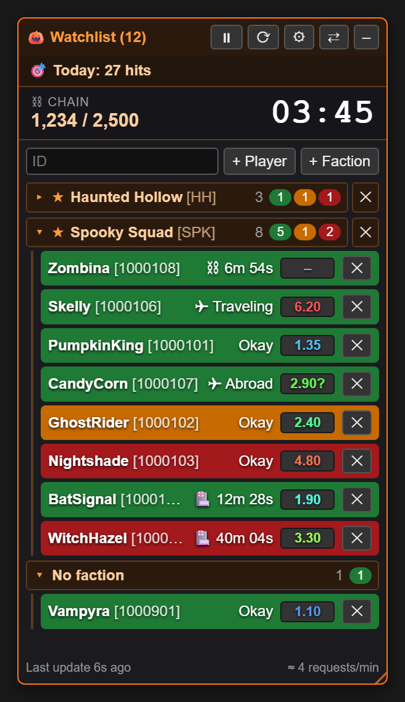

# 🎃 Torn War Watchlist

**Behalte deine Gegner im Ranked War im Blick: wer online ist, wer im Hospital liegt, wie stark jemand ist und wie viel Zeit die Chain noch hat. Alles in einem kleinen Panel direkt in Torn.**

### [⬇️ Jetzt installieren](https://raw.githubusercontent.com/Provadis/torn-war-watchlist/main/torn-war-watchlist.user.js)

> [!NOTE]
> Ein Spaßprojekt, **komplett mit KI entwickelt**. Benutzung auf eigene Gefahr – mehr dazu im [Disclaimer](#%EF%B8%8F-disclaimer) ganz unten.

---

## 📑 Inhalt

- [Funktionen](#-funktionen)
- [Installation & Updates](#-installation--updates)
- [Einrichtung](#-einrichtung)
- [API-Verbrauch](#-api-verbrauch)
- [Legende](#-legende)
- [Datenschutz](#-datenschutz)
- [FAQ & Probleme](#-faq--probleme)
- [Changelog](#-changelog)
- [English summary](#-english-summary)
- [Disclaimer](#%EF%B8%8F-disclaimer)

---

## ✨ Funktionen

### 👥 Watchlist für Spieler und ganze Factions
- **Einzelne Spieler** fügst du per ID oder direkt auf ihrem Profil hinzu („+ Spieler hinzufügen“).
- **Ganze Factions** gehen genauso: auf der Faction-Seite oder auf dem Profil eines Mitglieds („+ Faction hinzufügen“).
- **Sparsam:** Eine Faction kostet **einen einzigen API-Call** (`/v2/faction/{id}/members`), egal wie viele Mitglieder sie hat.
- **Ausblenden:** Einzelne Faction-Mitglieder blendest du mit ✕ aus, mit ↺ holst du alle wieder zurück.
- **Gruppen:** Spieler werden nach Faction gruppiert, und jede Gruppe lässt sich auf- und zuklappen. Die farbigen Zähler im Gruppenkopf zeigen auch im zugeklappten Zustand, wer wie lange weg ist.

### 🟢🟠🔴 Farben nach Last Action
| Farbe | Bedeutung |
|---|---|
| 🟩 Grün | über 15 min inaktiv – vermutlich offline |
| 🟧 Orange | 10–15 min inaktiv |
| 🟥 Rot | unter 10 min – gerade aktiv |

### 🏥 Hospital-Countdown & Status
Statt „wie lange offline“ zeigt jede Zeile den **Status**:
- **Okay** = angreifbar
- **🏥 12m 30s** = Restzeit im Hospital
- **⛓** = Restzeit im Jail
- **✈** = reist bzw. ist im Ausland

Sortiert wird so, dass angreifbare Spieler oben stehen (am längsten inaktiv zuerst). Danach kommen die Hospital-Patienten, wer als Nächstes rauskommt, zuerst.

### 📊 FF Scouter
Zeigt den **Fair-Fight-Wert** jedes Spielers von [ffscouter.com](https://ffscouter.com):
- **Farbe:** blau = leicht, grün/gelb = mittel, rot = schwer.
- **Tooltip:** geschätzte Stats und wie alt die Schätzung ist.
- **Abfragen:** bis zu 100 Spieler in einem Call, 30 Minuten zwischengespeichert.

### ⛓ Chain-Timer mit Alarm
- Den Chain-Stand liest das Skript direkt von der Seite (Sidebar oder Angriffsseite) und zeigt ihn groß an. Das kostet keinen API-Call.
- **Unter 1:30** blinkt die Box rot und das ganze Panel leuchtet.
- Optional gibt es den **💣 Bomben-Sound**: Ab 1:30 piept es, ab 0:30 immer schneller, bei 0 kommt die Explosion samt Blitz. Ein gelandeter Hit entschärft die Bombe.

  
  &nbsp;&nbsp;
  

### 🎯 Today's Hits
Zählt deine **erfolgreichen Angriffe seit 00:00 TCT**. Dafür braucht es einen Key mit Limited Access.

### 🪟 Frei verschiebbar & anpassbar
- **Verschieben:** am Kopf ziehen, Doppelklick dockt das Panel wieder an den Rand an.
- **Größe** über die Ecke unten ändern.
- **Einklappen** mit –.

Alles wird gespeichert und gilt in allen Torn-Tabs.

### ⚙ Einstellungen & Sprache
Alle Optionen liegen auf einer eigenen Einstellungsseite hinter **⚙**. Die Oberfläche gibt es auf **Deutsch und Englisch**, umschaltbar ohne Neuladen. Unten auf der Einstellungsseite steht eine **Legende**, die jede Markierung erklärt.

  
  &nbsp;&nbsp;
  

### 💾 Export, Import & Sicherung
- **⬇ Export / ⬆ Import:** Einstellungen, API-Keys, Spieler und Factions als Datei sichern und wiederherstellen.
- **Automatische Sicherung:** Zusätzlich wird alles im Browser-Speicher gesichert und beim Laden automatisch zurückgespielt, falls der Tampermonkey-Speicher einmal leer ist.

### 🌈 Nyan Cat
Läuft ab und zu um den Rand des Panels, mit Regenbogen. Lässt sich abschalten. Einfach so, weil es geht.

---

## 📥 Installation & Updates

1. **[Tampermonkey](https://www.tampermonkey.net/)** im Browser installieren (Chrome, Edge, Firefox, Opera …).
2. **[Diesen Link öffnen](https://raw.githubusercontent.com/Provadis/torn-war-watchlist/main/torn-war-watchlist.user.js)** → Tampermonkey zeigt die Installationsseite → **Installieren**.
3. [torn.com](https://www.torn.com) neu laden – rechts erscheint das 🎃-Panel.

### Updates
- **Automatisch:** Tampermonkey sucht selbst nach neuen Versionen, standardmäßig einmal am Tag. Das Intervall stellst du unter *Tampermonkey → Einstellungen → Script-Update-Prüfintervall* ein.
- **Sofort:** ⚙ → **🔄 Nach Updates suchen**, oder im Tampermonkey-Dashboard *Nach Userscript-Updates suchen*.
- **Deine Daten bleiben bei Updates erhalten:** Liste, Keys und Einstellungen.

---

## 🔧 Einrichtung

| Was | Wo | Hinweis |
|---|---|---|
| **Torn API-Key** | ⚙ → 🔑 Torn API-Key | *Public* reicht für die Watchlist. Für **Today's Hits** braucht es *Limited*. |
| **FF Scouter** | ⚙ → 📊 FF Scouter anhaken → **Key** | Ein Torn-API-Key, der bei [ffscouter.com](https://ffscouter.com) registriert ist. Leer lassen = den Watchlist-Key verwenden. |
| **Update-Intervall** | ⚙ → Update alle … s | 15–600 Sekunden, Standard 60. |
| **Sprache** | ⚙ → Sprache | Deutsch / English |

---

## 📈 API-Verbrauch

Torn erlaubt **100 Abfragen pro Minute pro Account**, für alle Keys zusammen. Die Watchlist braucht pro Update:

- **1 Call pro beobachteter Faction**, egal wie viele Mitglieder
- **1 Call pro Einzelspieler**, der nicht schon über eine Faction abgedeckt ist
- **1 Call** für Today's Hits (wenn aktiv)

Die aktuelle Rate steht **unten rechts im Panel** (z. B. „≈ 4 Abfragen/min“) und wird ab 60/min orange.

Weitere Sparmaßnahmen:
- Bei mehreren offenen Torn-Tabs fragt **nur ein Tab** ab, die anderen bekommen die Daten über den gemeinsamen Speicher.
- Mit ⏸ pausierst du alle Abfragen.
- FF-Scouter-Abfragen gehen an ffscouter.com und zählen nicht gegen Torns Limit.

---

## 📖 Legende

| Markierung | Bedeutung |
|---|---|
| 🟩 / 🟧 / 🟥 Zeile | Last Action: > 15 min / 10–15 min / < 10 min |
| ⬛ graue Zeile | noch keine Daten |
| `Okay` | nicht im Hospital – angreifbar |
| `🏥 12m 30s` | im Hospital, Restzeit |
| `⛓ 5m 00s` | im Jail, Restzeit |
| `✈ Reist` / `✈ Ausland` | fliegt gerade / ist im Ausland |
| FF **blau → rot** | leicht → schwer |
| `2.10?` | FF-Schätzung älter als 14 Tage |
| `–` / `…` | keine FF-Daten / wird geladen |
| ★ | Faction steht auf der Watchlist |
| ⛓ rot blinkend | Chain-Timer unter 1:30 |
| ✕ / ↺ | entfernen bzw. ausblenden / wiederherstellen |

Die gleiche Legende findest du im Skript unter **⚙ → 📖 Legende**, mit einem erfundenen Beispielspieler.

 

---

## 🔒 Datenschutz

- **Deine API-Keys und Listen bleiben lokal** im Tampermonkey-Speicher, plus eine Sicherung im `localStorage` von torn.com. Sie stehen nirgends im Code und werden nicht hochgeladen.
- **Netzwerk:** Das Skript spricht nur mit `api.torn.com` und (wenn aktiviert) `ffscouter.com`.
- ⚠️ **Die Export-Datei enthält deinen API-Key im Klartext.** Gib sie nicht weiter.
- ⚠️ Andere Userscripts auf torn.com könnten die Sicherung im `localStorage` lesen.

---

## ❓ FAQ & Probleme

<b>Unten steht „Kein API-Key gesetzt“ oder ein API-Fehler</b>

⚙ → 🔑 Torn API-Key und den Key prüfen. Bei „Incorrect key“ ist der Key falsch oder gelöscht.

<b>Today's Hits zeigt „braucht Limited-Key“</b>

Für die Angriffsliste braucht Torn einen Key mit mindestens *Limited Access*. Erstelle in Torn unter *Settings → API Keys* einen neuen Key und trage ihn ein.

<b>FF Scouter: „Key nicht bei FF Scouter registriert“</b>

Melde den Key einmal auf [ffscouter.com](https://ffscouter.com) an oder trage unter ⚙ → FF Scouter → **Key** einen Key ein, der dort registriert ist.

<b>Der Bomben-Sound bleibt stumm</b>

Browser spielen erst Ton ab, wenn du nach dem Laden einmal auf die Seite geklickt oder eine Taste gedrückt hast. Mit ⚙ → ▶ Test kannst du es ausprobieren. Bei mehreren Tabs piept nur einer, bevorzugt der sichtbare.

<b>Die Chain-Box fehlt oder zeigt Unsinn</b>

Die Chain wird aus Torns Sidebar bzw. von der Angriffsseite gelesen. Prüfe, ob ⚙ → Chain-Timer angehakt ist. Wenn Torn das Layout ändert, kann das Auslesen kaputtgehen – dann bitte ein Issue mit Screenshot aufmachen.

<b>Meine Liste ist nach dem Neuladen weg</b>

Das Skript spielt seine Browser-Sicherung automatisch zurück. Falls trotzdem etwas fehlt: ⚙ → ⬆ Import mit deiner letzten Export-Datei.

---

## 📝 Changelog

| Version | Neu |
|---|---|
| **2.11.0** | Automatische Updates über GitHub, Versionsanzeige und „Nach Updates suchen“, anonymisierte Legende |
| **2.10.x** | Legende in den Einstellungen, Scrollbalken im Panel-Design, Abfragen/min in der Fußzeile |
| **2.9.0** | Eigene Einstellungsseite, Deutsch/Englisch, Status vor FF-Wert |
| **2.8.0** | FF-Scouter-Integration |
| **2.7.x** | Export/Import, automatische Browser-Sicherung, Fix für die Chain-Anzeige |
| **2.6.0** | Bomben-Sound für den Chain-Timer |
| **2.5.0** | Panel frei verschiebbar |
| **≤ 2.4** | Watchlist, Factions mit einem Call, Gruppen, Hospital-Countdown, Today's Hits, Chain-Timer, Nyan Cat |

---

## 🇬🇧 English summary

**Torn War Watchlist** is a Tampermonkey userscript for [Torn City](https://www.torn.com) ranked wars. It shows a compact panel with your targets:
- **Rows colored by last action:** green > 15 min, orange 10–15 min, red < 10 min.
- **Status:** hospital/jail countdowns, traveling, abroad.
- **FF Scouter** fair-fight scores.
- **Chain timer:** big display with a red alarm (and an optional bomb sound) below 1:30.
- **Today's hits** counter.

Whole factions cost just one API call per update. The UI is available in **English and German**: ⚙ → Language.

**Install:** get [Tampermonkey](https://www.tampermonkey.net/), then open the [install link](https://raw.githubusercontent.com/Provadis/torn-war-watchlist/main/torn-war-watchlist.user.js). Updates arrive automatically. Your API keys stay in your browser and are only sent to `api.torn.com` and `ffscouter.com`.

---

## ⚠️ Disclaimer

> [!CAUTION]
> ### 🤖 Komplett mit KI entwickelt · 🎉 Reines Spaßprojekt · 🛡️ Nutzung auf eigene Gefahr
>
> - **KI-generiert:** Dieses Projekt – Code, Texte und Bilder – wurde **vollständig mit KI erstellt**. Es gab kein professionelles Code-Review und keine umfassenden Tests auf Torn selbst.
> - **Just for fun:** Das Skript ist **aus Spaß** für einen Halloween-Ranked-War entstanden. Es ist kein offizielles Torn-Tool und steht in keiner Verbindung zu Torn oder ffscouter.com.
> - **Keine Haftung:** Die Nutzung erfolgt **auf eigene Gefahr**. Ich übernehme **keinerlei Haftung** – weder für Fehler, falsche Anzeigen, verpasste Chains oder Hits, noch für gesperrte oder verbrauchte API-Keys, Datenverlust oder sonstige Folgen.
> - **Regeln:** Du bist selbst dafür verantwortlich, dass deine Nutzung den [Torn-Regeln](https://www.torn.com/rules.php) und den API-Nutzungsbedingungen entspricht.
> - **Ohne Gewähr:** Die Software wird so bereitgestellt, wie sie ist, ohne jede Garantie (siehe [MIT-Lizenz](LICENSE)).
>
> ---
>
> **🇬🇧 English:** This project was **built entirely with AI**, made **just for fun**, and is **used at your own risk**. It is not affiliated with Torn or ffscouter.com. The author accepts **no liability** of any kind. Software provided "as is", without warranty.

Made with 🎃 and 🤖 for the Halloween war

