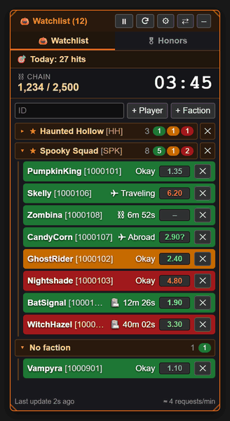
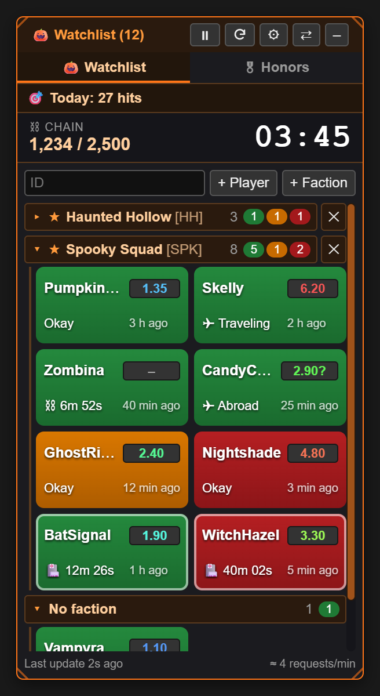
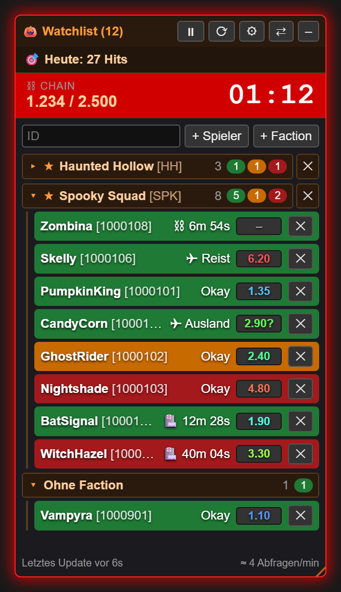
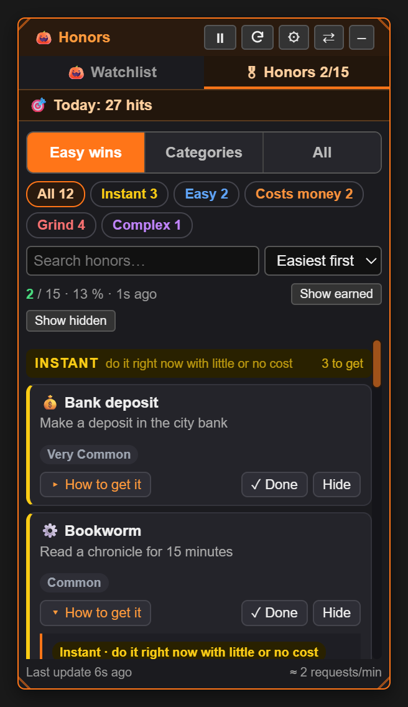
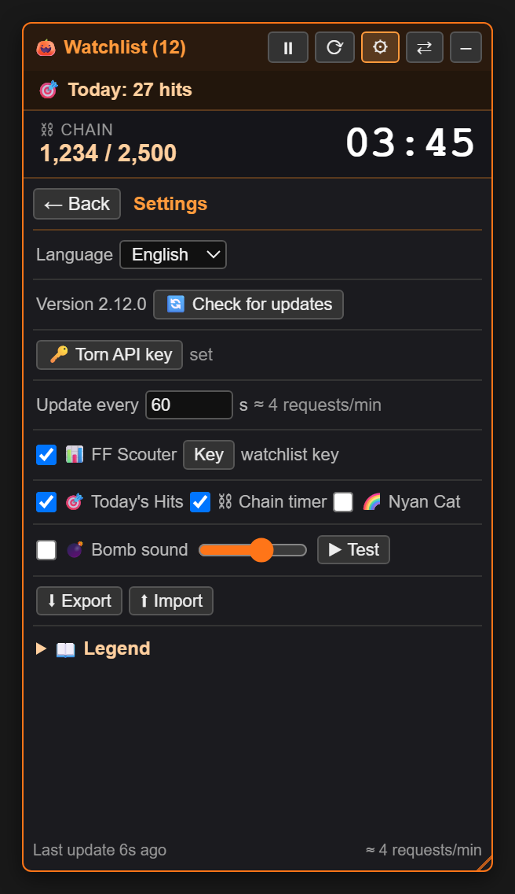
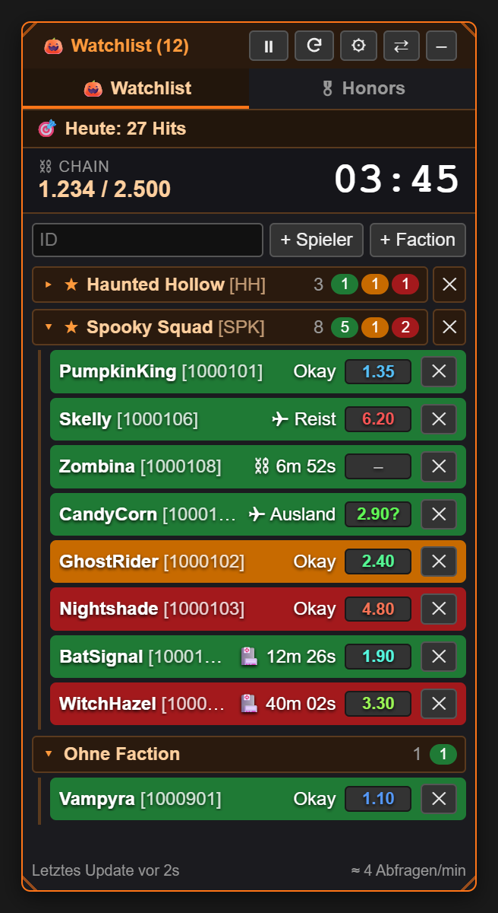
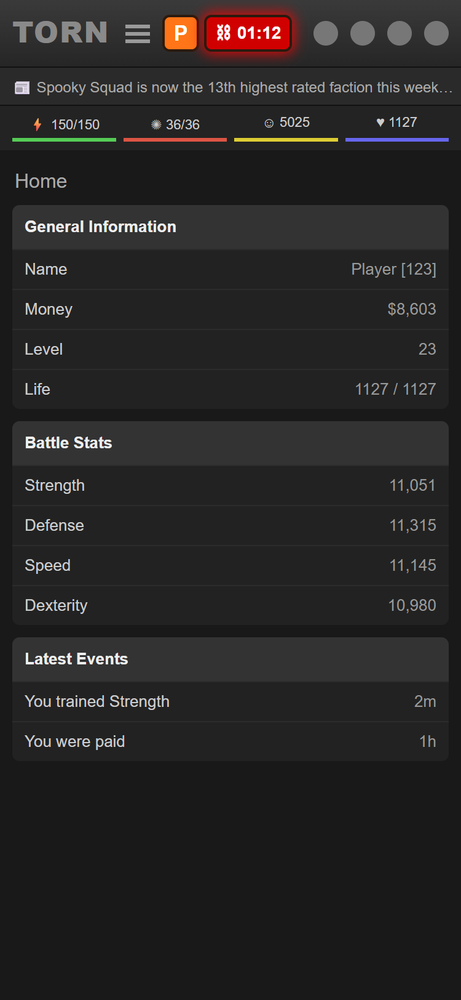
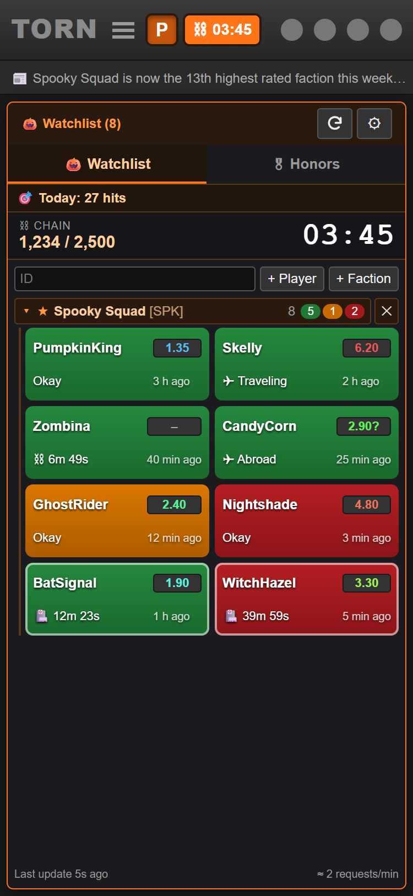
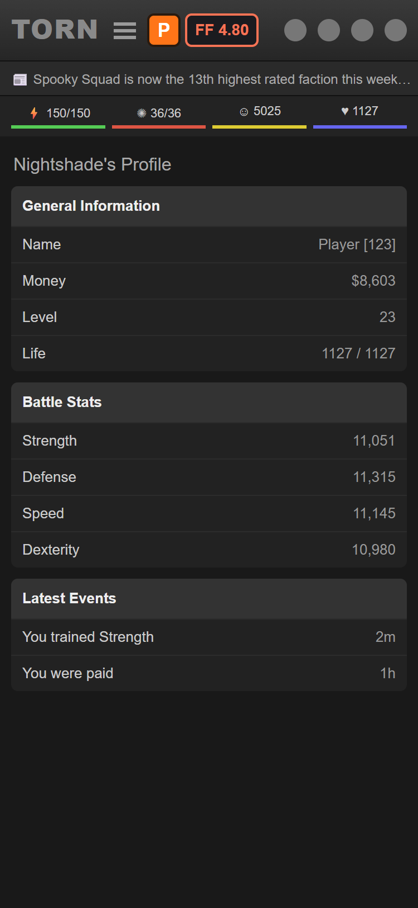
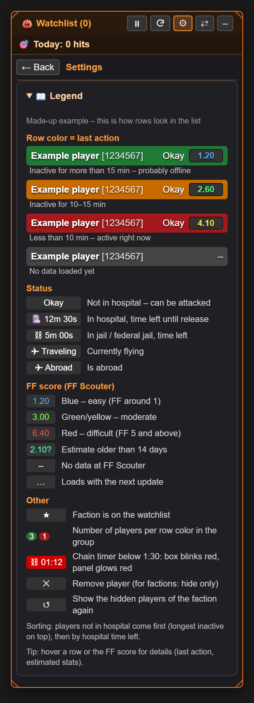

# 🎃 Torn War Watchlist

**Keep an eye on your ranked war targets: who is online, who is in hospital, how strong they are and how much time the chain has left – all in one small panel right inside Torn. On the PC and on your iPhone.**

  

> [!NOTE]
> A fun project, **built entirely with AI**. Use at your own risk – see the [disclaimer](#%EF%B8%8F-disclaimer) at the bottom.

---

## 📑 Contents

[Features](#-features) · [Screenshots](#-screenshots) · [Installation & updates](#-installation--updates) · [Setup](#-setup) · [Feature details](#-feature-details) · [API usage](#-api-usage) · [Legend](#-legend) · [API Terms of Service](#-api-terms-of-service) · [Privacy](#-privacy) · [FAQ](#-faq--troubleshooting) · [Changelog](#-changelog) · [Deutsch](#-kurzfassung-auf-deutsch) · [Disclaimer](#%EF%B8%8F-disclaimer)

---

## ✨ Features

<table>
<tr>
<td width="33%" valign="top">

**👥 Players & factions** 
Watch single players or whole factions – a faction costs just **one API call**, however big it is.

</td>
<td width="33%" valign="top">

**🟢🟠🔴 Last action colors** 
Green = away > 15 min, orange = 10–15 min, red = active right now.

</td>
<td width="33%" valign="top">

**🏥 Status & countdowns** 
Hospital and jail time left, traveling, abroad – attackable players on top.

</td>
</tr>
<tr>
<td valign="top">

**📊 FF Scouter** 
Fair fight score next to every player, colored from blue (easy) to red (hard).

</td>
<td valign="top">

**⛓ Chain timer & alarm** 
Big timer, red alarm below 1:30 and an optional 💣 bomb sound.

</td>
<td valign="top">

**🎖 Honor tracker** 
Own page in the menu: missing honors by difficulty, with how-to guides and progress bars.

</td>
</tr>
<tr>
<td valign="top">

**📱 Made for iPhone** 
P button in Torn's header, chain and FF badge, panel opens right below the header.

</td>
<td valign="top">

**🧱 List or tiles** 
Big 2-column tiles: tap = profile, long press = attack, copy, remove.

</td>
<td valign="top">

**⚔ Ranked war buttons** 
**+** (add to watchlist) and **📋 copy** right on the enemy list of a ranked war.

</td>
</tr>
<tr>
<td valign="top">

**🧭 Start menu & settings as tiles** 
Big tiles for watchlist, honors and settings; English and German, ✨ custom API key in one click.

</td>
<td valign="top">

**💾 Export & backup** 
Move list and settings between devices; automatic browser backup.

</td>
<td valign="top">

**🌈 Nyan Cat** 
Runs around the panel every now and then. Just because.

</td>
</tr>
</table>

---

## 📸 Screenshots

<table>
<tr>
<td align="center"> Watchlist</td>
<td align="center"> Tile view</td>
<td align="center"> Chain alarm below 1:30</td>
</tr>
<tr>
<td align="center"> Honor tracker</td>
<td align="center"> Settings</td>
<td align="center"> Deutsch</td>
</tr>
</table>

### 📱 On the iPhone

<table>
<tr>
<td align="center"> Closed: P + chain badge</td>
<td align="center"> Open below the header</td>
<td align="center"> FF badge on a profile</td>
</tr>
</table>

---

## 📥 Installation & updates

1. Install **[Tampermonkey](https://www.tampermonkey.net/)** in your browser (Chrome, Edge, Firefox, Opera …).
2. **[Open this link](https://raw.githubusercontent.com/Provadis/prvds-torn-tool/main/torn-war-watchlist.user.js)** → Tampermonkey shows its install page → **Install**.
3. Reload [torn.com](https://www.torn.com) – the 🎃 panel appears on the right.

### 📱 iPhone / iPad
Works with [Tampermonkey for Safari](https://apps.apple.com/app/tampermonkey/id6738342400) (iOS 15+):
1. Install Tampermonkey from the App Store.
2. *Settings → Safari → Extensions → Tampermonkey*: turn it on and allow it for torn.com (or all websites).
3. Open the [install link](https://raw.githubusercontent.com/Provadis/prvds-torn-tool/main/torn-war-watchlist.user.js) in **Safari** and install.
4. Move your list and keys over with ⬇ Export on the PC and ⬆ Import on the phone.

**What's different on the iPhone:**
- An orange **P** sits right after Torn's ☰ menu. Tap it to open the watchlist right below the header, in full screen height. Tap again to close it. Every new page starts with it closed.
- While a chain runs, a **timer badge** sits next to the P (e.g. **⛓ 03:45**) and blinks red below 1:30. Torn's mobile chain bar has no timer, so it comes from the Torn API, every 6 s and only while a chain runs.
- On a **profile page** the badge shows that player's **FF score** in its color. During a chain it takes turns with the timer every 2 s.
- **Tile view** (⚙ → View): tap a tile = profile, long press = attack, profile, copy, remove.
- Bigger touch targets everywhere; the war list buttons are always visible. If the header layout isn't recognized, a floating **P** square takes over.

### Updates
- **Automatic:** Tampermonkey checks for new versions on its own, once a day by default. You can change the interval under *Tampermonkey → Settings → Script update check interval*.
- **Right away:** ⚙ → **🔄 Check for updates** shows whether a newer version is on GitHub. To install it, use *Check for userscript updates* in the Tampermonkey menu (on a PC the „Install“ link next to the result works too).
- **Your data survives updates:** list, keys and settings stay.

---

## 🔧 Setup

| What | Where | Note |
|---|---|---|
| **Torn API key** | ⚙ → ✨ Create custom key, then 🔑 Torn API key | **✨ Create custom key** opens Torn's API key page with a pre-filled key that has exactly the access this script needs. You click *Create* there and paste the key into 🔑 Torn API key. A *Public* key also works for the watchlist; **Today's hits** and the **Honors** page need more (*Limited* or the custom key). |
| **FF Scouter** | ⚙ → 📊 FF Scouter tile → 🔑 FF key | A Torn API key registered at [ffscouter.com](https://ffscouter.com). Leave empty to use the watchlist key. |
| **Update interval** | ⚙ → Update interval | 15 s – 5 min, default 1 min. |
| **Language** | ⚙ → Language | English / Deutsch |

---

## 📚 Feature details

The overview is [above](#-features); here is how each part works.

<b>👥 Watchlist for players and whole factions</b>

- **Single players:** add them by ID or right on their profile („+ Add player“).
- **Whole factions:** same thing, on the faction page or on a member's profile („+ Add faction“).
- **Cheap on calls:** a faction costs **one single API call** (`/v2/faction/{id}/members`), no matter how many members it has.
- **Hiding:** hide single faction members with ✕, bring them all back with ↺.
- **Groups:** players are grouped by faction, and each group can be collapsed. The colored counters in the group header show who has been away how long, even when the group is collapsed.

<b>⚔ Buttons in the ranked war list</b>

On the ranked war page, hovering an enemy's row pops up two small buttons over the right end of their name (on touch screens they are always visible):
- **+** puts the player on your watchlist. Once they are on it, it turns into a green **✓** – click it again to remove them.
- **📋 Copy** puts `Name [ID]` into the clipboard as a link to their profile, plus a plain-text version (`Name [ID] – profile link`) for chats that only take text.

Both read name and ID straight from the row – no API calls. They also survive Torn redrawing the list and work alongside other scripts' columns (e.g. FF Scouter).

<b>🟢🟠🔴 Colors by last action</b>

| Color | Meaning |
|---|---|
| 🟩 Green | inactive for more than 15 min – probably offline |
| 🟧 Orange | inactive for 10–15 min |
| 🟥 Red | less than 10 min – active right now |

<b>🏥 Hospital countdown & status</b>

Instead of „offline for …“ every row shows the **status**:
- **Okay** = can be attacked
- **🏥 12m 30s** = hospital time left
- **⛓** = jail time left
- **✈** = traveling or abroad

The list is sorted so that attackable players come first (longest inactive on top). Players in hospital follow, whoever gets out next first.

<b>📊 FF Scouter</b>

Shows every player's **fair fight score** from [ffscouter.com](https://ffscouter.com):
- **Color:** blue = easy, green/yellow = moderate, red = difficult.
- **Tooltip:** estimated stats and how old the estimate is.
- **Requests:** up to 100 players per call, cached for 30 minutes.
- **🔄 Reload FF** (⚙ → FF Scouter) clears that cache and fetches all scores right away – handy after the gym, since FF depends on your own stats too.

<b>⛓ Chain timer with alarm</b>

- The script reads the chain straight from the page (sidebar or attack page) and shows it big. This costs no API calls.
- **Below 1:30** the box blinks red and the whole panel glows.
- Optional **💣 bomb sound**: beeps from 1:30, faster and faster from 0:30, and explodes with a flash at 0. A landed hit defuses the bomb.

<b>🎯 Today's hits</b>

Counts your **successful attacks since 00:00 TCT**. This needs a key with Limited access.

<b>🪟 Movable & resizable</b>

- **Move:** drag the header. Double-click docks the panel back to the edge.
- **Resize** from any of the four corners (bigger handles on touch screens). A saved size that doesn't fit the screen – e.g. imported from a PC onto a phone – is shrunk to fit automatically.
- **Collapse** with –.

Everything is saved and shared across all Torn tabs.

<b>⚙ Settings & language</b>

The panel has a **start menu** with big tiles: 🎃 Watchlist, 🎖 Honors and ⚙ Settings (🏅 Medals is coming). Each tile shows its key number, e.g. players and how many are okay, or honors earned. **‹ Menu** in the header leads back from every page. Chain timer and today's hits stay on top of every page. Under *Start page* you choose whether the panel opens on the **last opened page** (default) or on the **menu**. The tiles keep their size: a wider panel fits more per row.

All options live on their own settings page behind the **⚙ Settings** tile, laid out as a grid: on/off options are tiles you click or tap (orange = on, grey = off), keys and data are dashed tiles, and language, view and update interval are switch bars. Hover a tile on the PC for a short explanation. The UI is available in **English and German** and switches instantly, without a reload. At the bottom of the settings page there is a **legend** explaining every marker.

<b>🎖 Honor tracker</b>

Its own page in the start menu (PC and iPhone) shows which **honors** you're still missing and how to get them:
- **Easy wins:** missing honors grouped by difficulty – *Instant, Easy, Costs money, Grind, Complex* – with a short **how-to guide** for each.
- **Categories** (as tappable chips) and **All**, plus search and sorting (easiest, rarest, A–Z).
- **Progress bars** from your personal stats, e.g. „Attacks won 184 / 250“.
- Mark honors as **done** or **hide** them; both are part of export/import. **🔄 Sync** loads your real state from Torn and resets the ✓ marks (hidden ones stay hidden).

It uses the same Torn API key (at least *Limited* access) and makes 3 requests every 5 minutes, **only while the page is open**. Honor bar images load from torn.com itself; there are no other servers involved. The guides are in English.

> Guide data, difficulty tiers and progress mapping are adapted from [Torn City – Merit Tracker](https://greasyfork.org/scripts/579300) by Solenya (MIT License).

<b>💾 Export, import & backup</b>

- **⬇ Export / ⬆ Import:** save settings, API keys, players and factions to a file and restore them.
- **Automatic backup:** everything is also backed up in the browser's storage and restored automatically on load if the Tampermonkey storage ever ends up empty.

<b>🌈 Nyan Cat</b>

Runs around the panel border every now and then, rainbow included – but not while the panel is collapsed. Can be switched off. Just because.

---

## 📈 API usage

Torn allows **100 requests per minute per account**, for all keys combined. Per update the watchlist needs:

- **1 call per watched faction**, no matter how many members
- **1 call per single player** not already covered by a faction
- **1 call** for today's hits (if enabled)
- Honor tracker: **3 calls every 5 minutes**, only while its page is open

The current rate is shown **bottom right in the panel** (e.g. „≈ 4 requests/min“) and turns orange above 60/min.

More ways the script saves calls:
- With several Torn tabs open, **only one tab** makes requests; the others get the data via the shared storage.
- ⏸ pauses all requests.
- FF Scouter requests go to ffscouter.com and don't count against Torn's limit.

---

## 📖 Legend

| Marker | Meaning |
|---|---|
| 🟩 / 🟧 / 🟥 row | last action: > 15 min / 10–15 min / < 10 min |
| ⬛ gray row | no data yet |
| `Okay` | not in hospital – can be attacked |
| `🏥 12m 30s` | in hospital, time left |
| `⛓ 5m 00s` | in jail, time left |
| `✈ Traveling` / `✈ Abroad` | currently flying / is abroad |
| FF **blue → red** | easy → difficult |
| `2.10?` | FF estimate older than 14 days |
| `–` / `…` | no FF data / loading |
| ★ | faction is on the watchlist |
| ⛓ blinking red | chain timer below 1:30 |
| ✕ / ↺ | remove or hide / restore |

The same legend is built into the script under **⚙ → 📖 Legend**, with a made-up example player.

Screenshot: the legend in the panel

---

## 📜 API Terms of Service

How this script uses your Torn API key, following [Torn's API ToS guidelines](https://www.torn.com/api.html):

| Data Storage | Data Sharing | Purpose of Use | Key Storage & Sharing | Key Access Level |
|---|---|---|---|---|
| `Only locally` | `Nobody` | `Not eligible – only the end user has access` | `Stored locally / Not shared` | `Custom` – `user: basic, profile, attacks, honors, personalstats` · `faction: basic, members, chain` · `torn: honors` |

**In plain words:** everything stays in your browser. The key, your lists, settings and cached data (player status, faction members, FF values, honors) are kept in the Tampermonkey storage, with a backup in torn.com's `localStorage`. Nothing is sent to a server of the script author. There is none. The key is only used to read your own game data for your own panel.

**Custom key (recommended):** ⚙ → **✨ Create custom key** opens Torn's own key form, pre-filled with exactly the selections listed above, nothing more. The script never creates a key by itself. You check the access and click *Create* on Torn's page. Where you enter a key, the panel shows a short note on how it's used.

**Other keys work too:** a *Public* key is enough for the watchlist, factions and the chain timer. *Today's hits* and the *Honors* page need *Limited* (or the custom key). The table below shows which level covers each selection.

**Requests made with your key** go to `api.torn.com` only, each tagged with `comment=watchlist`. You can see them in your [API key log](https://www.torn.com/preferences.php#tab=api) (*key → log*):

Which requests, for what, with which access

| Selection | Used for | In the custom key / without it |
|---|---|---|
| `user/{id}?selections=profile` | Name, status, last action and faction of watched players / the profile you're viewing | ✓ / Public |
| `user/?selections=basic` | Your own player ID (once per key) | ✓ / Public |
| v2 `faction/{id}/basic`, `faction/{id}/members` | Watched factions and their members | ✓ / Public |
| v2 `faction/chain` | Chain timer on iPhone/iPad (every 6 s while a chain runs, otherwise only on page load) | ✓ / Public |
| v2 `user/attacks` | Today's hits | ✓ / Limited |
| v2 `torn/honors`, `user/honors`, `user/personalstats` | Honors page, only while it's open | ✓ / Limited |

**Integrations:**
- **FF Scouter: opt-in, off by default.** When you switch it on, your FF Scouter key goes to `ffscouter.com` together with the IDs of the players shown in the panel, to fetch fair-fight estimates. If you didn't set a separate FF key, that's your watchlist key. FF Scouter's own terms apply, see [ffscouter.com](https://ffscouter.com).
- **Update check: GitHub, no key.** Only when you press *Check for updates* does the script ask `api.github.com` / `raw.githubusercontent.com` for the newest version. No key and no game data are sent.

---

## 🔒 Privacy

- **Your API keys and lists stay local:** in the Tampermonkey storage, plus a backup in torn.com's `localStorage`. They are not in the code and are never uploaded.
- **Network:** the script only talks to `api.torn.com`, `ffscouter.com` (if FF Scouter is on) and GitHub (only when you check for updates, without key). Details: [API Terms of Service](#-api-terms-of-service).
- ⚠️ **The export file contains your API key in plain text.** Don't share it.
- ⚠️ Other userscripts running on torn.com could read the `localStorage` backup.

---

## ❓ FAQ & troubleshooting

<b>The footer says „No API key set“ or shows an API error</b>

Check your key under ⚙ → 🔑 Torn API key. „Incorrect key“ means the key is wrong or was deleted.

<b>Today's hits shows „needs a Limited key“</b>

Torn only returns the attack list for keys with at least *Limited access*. Create a new key in Torn under *Settings → API Keys* and enter it.

<b>FF Scouter: „Key not registered with FF Scouter“</b>

Register the key once at [ffscouter.com](https://ffscouter.com), or enter a key that is registered there under ⚙ → FF Scouter → **Key**.

<b>The bomb sound stays silent</b>

Browsers only play sound after you have clicked on the page or pressed a key once since it loaded. Try it with ⚙ → ▶ Test. With several tabs open, only one beeps, preferably the visible one.

<b>The chain box is missing or shows nonsense</b>

The chain is read from Torn's sidebar or the attack page. Check that ⚙ → Chain timer is ticked. If Torn changes its layout, reading may break – please open an issue with a screenshot.

<b>iPhone: the install link only shows code / Tampermonkey finds no update</b>

- **Code instead of an install screen:** Tampermonkey can only take over pages it is allowed on. Allow it for all websites (*Settings → Safari → Extensions → Tampermonkey*), or open the link and choose *Aa / puzzle icon → Tampermonkey → Always allow on this website*. If it still shows code, briefly turn off Safari's pop-up blocker while installing.
- **No update found:** GitHub serves the normal file address from a cache for up to ~5 minutes after a release, so Tampermonkey's own check may still see the old version – try again a little later, or use ⚙ → 🔄 Check for updates, which sees new releases right away and links the install to the fresh file. If the script was created by pasting the code, install it once via the link, so Tampermonkey keeps it updated.

<b>My list is gone after a reload</b>

The script restores its browser backup automatically. If something is still missing: ⚙ → ⬆ Import with your latest export file.

---

## 📝 Changelog

| Version | What's new |
|---|---|
| **2.24.0** | **Start menu** with big tiles instead of the tabs: Watchlist, Honors, Settings (Medals coming soon), each with its key number. **‹ Menu** leads back; new setting *Start page* (last opened page or menu) |
| **2.23.3** | The GitHub repo is now called **prvds-torn-tool**: install, update and help links point to the new address (old links keep forwarding) |
| **2.23.2** | iPhone/iPad: the panel starts closed on every page (reload, opening a target …) – the P opens it. PC keeps remembering it |
| **2.23.1** | ToS: key access level is *Custom* with the exact selections; the tile is now called **✨ Create custom key** |
| **2.23.0** | **✨ Create custom key** in the settings opens Torn's pre-filled key form with only the needed access; key prompts and settings show how the key is used (API ToS) |
| **2.22.1** | Smoother on iPhone: panel no longer resizes while Safari's address bar slides, honor images keep their space before loading, lists don't pull the page along at their ends, far less background work |

Older versions

| Version | What's new |
|---|---|
| **2.22.0** | Soft fold/unfold animation for faction groups, honor difficulty sections and the how-to guides (off with „reduce motion“) |
| **2.21.4** | Honors: cards get a soft color glow from the left in their tier color (green when earned) |
| **2.21.3** | Honors: Sync (and ⟳) now resets your own ✓ marks to Torn's real state, so a wrongly ticked honor comes back |
| **2.21.2** | Honors: tap a difficulty header in „Easy wins“ to fold that section (remembered); orange **🔄 Sync** button right in the tab |
| **2.21.1** | Fix: the honors list no longer shows below the watchlist in a resized panel |
| **2.21.0** | New **Honors** tab: missing honors by difficulty with how-to guides, categories, search, progress bars, done/hide marks (based on the MIT-licensed Merit Tracker by Solenya) |
| **2.20.1** | iPhone: no more flash of the old floating P on page load – the fallback only shows if Torn's header really can't be found |
| **2.20.0** | iPhone: on a profile page the header badge shows that player's FF score in its color; while a chain runs it takes turns with the chain timer every 2 seconds |
| **2.19.0** | The tile grid settings page now on the PC too (with hover effects and tooltips); new settings screenshot |
| **2.18.1** | iPhone: the panel below the header ends at the bottom of the screen (no longer hidden behind Safari's address bar); no pause button in the header on touch screens (it is a tile in ⚙) |
| **2.18.0** | New view setting: list or 2-column tiles (tap = profile, long press = attack / profile / copy / remove). Refresh button with a real icon; on touch screens bigger ⚙ and refresh buttons, no dock button and no – while the header P toggles the panel |
| **2.17.0** | Touch settings as a grid: on/off tiles (orange = on), key tiles, tap bars for language and update interval; volume only shows while the bomb sound is on. Desktop keeps the classic rows |
| **2.16.5** | „Check for updates“ finds a new release right away (asks GitHub for the newest commit instead of the cached file) and links the install to exactly that file |
| **2.16.4** | Header timer badge (and its API requests) respect the chain timer setting |
| **2.16.3** | No tooltip on the header P button (it stuck on iPhone after a tap) |
| **2.16.2** | Smooth mobile chain timer: bypasses Torn's API cache and counts down to an absolute end time (no more jumping back up) |
| **2.16.1** | P button in the header reliably toggles on iPhone (reacts to the touch directly, sits above Torn's header elements) |
| **2.16.0** | Touch screens: P button and chain timer badge in Torn's header, watchlist opens inline below the header in full height, chain timer via API (every 6 s while a chain runs) |
| **2.15.0** | „P“ square for a collapsed panel on touch screens, Nyan Cat pauses while collapsed |
| **2.14.0** | Resize from all four corners (touch-friendly), panel always fits the screen, update check inside the script, iPhone instructions |
| **2.13.1** | War list buttons only appear on hover, as a small overlay |
| **2.13.0** | + and copy buttons next to every enemy in the ranked war list |
| **2.12.1** | „🔄 Reload FF“ button to refetch all FF scores right away |
| **2.12.0** | English as the default language, code comments and README in English |
| **2.11.0** | Automatic updates via GitHub, version display and „Check for updates“, anonymized legend |
| **2.10.x** | Legend in the settings, scrollbars in the panel style, requests/min in the footer |
| **2.9.0** | Separate settings page, English/German, status before the FF score |
| **2.8.0** | FF Scouter integration |
| **2.7.x** | Export/import, automatic browser backup, chain display fix |
| **2.6.0** | Bomb sound for the chain timer |
| **2.5.0** | Freely movable panel |
| **≤ 2.4** | Watchlist, factions with one call, groups, hospital countdown, today's hits, chain timer, Nyan Cat |

---

## 🇩🇪 Kurzfassung auf Deutsch

**Torn War Watchlist** ist ein Tampermonkey-Userscript für Ranked Wars in [Torn City](https://www.torn.com). Es zeigt ein kompaktes Panel mit deinen Gegnern:
- **Zeilenfarbe nach Last Action:** grün über 15 min, orange 10–15 min, rot unter 10 min.
- **Status:** Hospital-/Jail-Countdown, unterwegs, im Ausland.
- **FF-Scouter-Werte.**
- **Chain-Timer:** große Anzeige mit rotem Alarm (optional mit Bomben-Sound) unter 1:30.
- **Zähler für die heutigen Hits.**
- **Startmenü mit Kacheln:** Watchlist, Honors und Einstellungen auf einen Blick, „‹ Menü“ führt zurück.
- **Honor-Tracker:** fehlende Honors nach Schwierigkeit, mit Anleitung (englisch), Kategorien und Fortschritt.

Ganze Factions kosten nur einen API-Call pro Update. Die Oberfläche gibt es auf **Englisch und Deutsch**: ⚙ → Sprache.

**Installation:** [Tampermonkey](https://www.tampermonkey.net/) installieren und den [Installations-Link](https://raw.githubusercontent.com/Provadis/prvds-torn-tool/main/torn-war-watchlist.user.js) öffnen. Updates kommen danach automatisch. Deine API-Keys bleiben in deinem Browser und gehen nur an `api.torn.com` und `ffscouter.com`.

---

## ⚠️ Disclaimer

> [!CAUTION]
> ### 🤖 Built entirely with AI · 🎉 Just for fun · 🛡️ Use at your own risk
>
> - **AI-generated:** this project – code, texts and images – was **created entirely with AI**. There was no professional code review and no extensive testing on Torn itself.
> - **Just for fun:** the script was made **for fun** for a Halloween ranked war. It is not an official Torn tool and has no affiliation with Torn or ffscouter.com.
> - **No liability:** you use it **at your own risk**. I accept **no liability whatsoever** – not for bugs, wrong data, missed chains or hits, locked or used-up API keys, data loss or any other consequences.
> - **Rules:** you are responsible for making sure your use complies with the [Torn rules](https://www.torn.com/rules.php) and the API terms of use.
> - **No warranty:** the software is provided as is, without any warranty (see the [MIT license](LICENSE)).
>
> ---
>
> **🇩🇪 Deutsch:** Dieses Projekt wurde **vollständig mit KI entwickelt**, ist **nur aus Spaß** entstanden und wird **auf eigene Gefahr** benutzt. Es steht in keiner Verbindung zu Torn oder ffscouter.com. Ich übernehme **keinerlei Haftung**. Ohne Gewähr.

Made with 🎃 and 🤖 for the Halloween war

